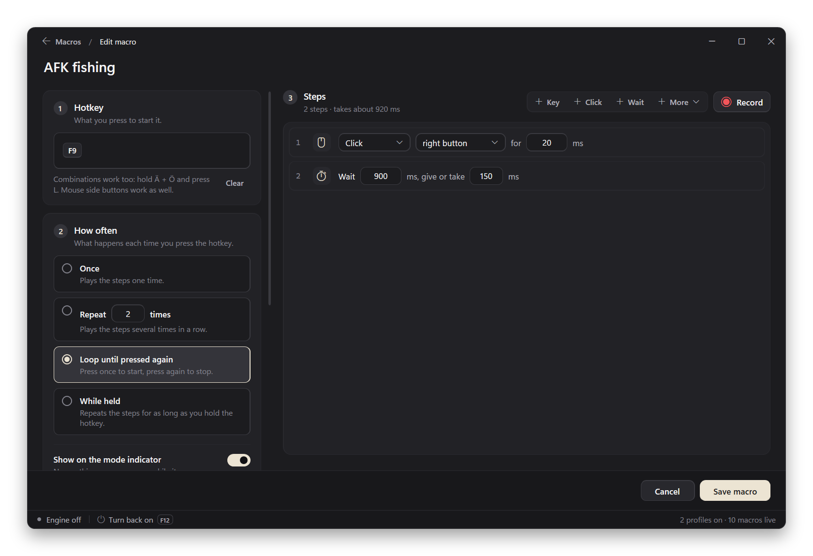
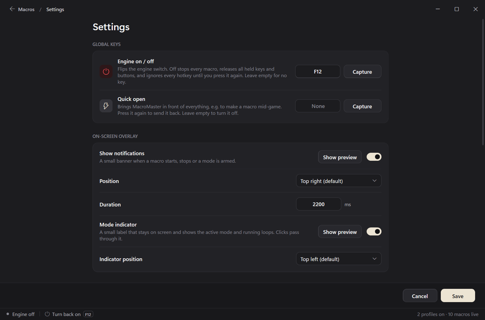

# MacroMaster

Hotkeys, auto clickers and game macros for Windows, built in a visual editor. No scripting.

**[Download for Windows (.zip)](https://github.com/OlfJD/MacroMaster/releases/latest/download/MacroMaster-win-x64.zip)**. Portable: extract and run `MacroMaster.exe`. Needs the [.NET 10 Desktop Runtime](https://dotnet.microsoft.com/download/dotnet/10.0).


## Features

- **Any hotkey**: a key, a combination like `Ctrl + Alt + S`, chords like `Ä + Ö + L`, or the mouse side buttons.
- **Four ways to run**: once, a number of times, in a loop until pressed again, or while the key is held.
- **Steps**: keys, clicks, waits, mouse moves, scrolling, typed text, media keys, repeat blocks and *wait until a pixel turns a colour*. Or hit **Record** and do it once yourself; the timing is kept.
- **Give or take**: a wait of 900 ± 150 ms lasts anywhere between 750 and 1050 ms, so timing doesn't look robotic.
- **Profiles per game or app**: switch whole profiles on and off. A macro limited to one program only reacts there, and its loop stops when you alt-tab away.
- **Mode groups**: several macros on one hotkey, with switch keys picking which one runs.
- **On-screen overlay**: a small notification when a macro starts or stops, and an optional mode indicator showing the active mode and running loops. Any corner or a spot you drag yourself.
- **Starts with Windows**, as administrator if you like, so hotkeys also work in games that run as administrator.
- **Quiet updates** from GitHub releases, installed when no macro is running.
- **Scales to your screen** (1080p, 1440p, 4K) or to the size you pick, with your own accent colour.
- **AutoHotkey import**: drop an `.ahk` script on the window. Profiles and single macros export as files.



<details>
<summary>Mode groups and settings</summary>




</details>

## Shortcuts

| Keys | Action |
| --- | --- |
| `F12` | Engine on / off: stops every macro and releases held keys |
| Quick open (Settings) | Bring MacroMaster to the front mid-game |
| Switch key of a mode group | Pick which macro the shared hotkey runs |

Notifications don't show over a game in exclusive fullscreen (e.g. Minecraft with `F11`). Windows draws nothing else there; use windowed or borderless fullscreen.

## Build

```bash
git clone https://github.com/OlfJD/MacroMaster.git
cd MacroMaster
dotnet run
```

Needs the .NET 10 SDK. `dotnet test Tests` runs the tests; they never touch your keyboard or mouse. To release, bump `<Version>` in `MacroMaster.csproj`, `dotnet publish -c Release`, zip the output as `MacroMaster-win-x64.zip` and attach it to a release tagged `v<version>`. `DEVLOG.md` has the architecture, changelog and to-do list.
