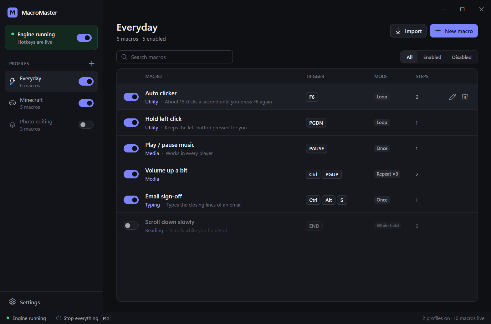
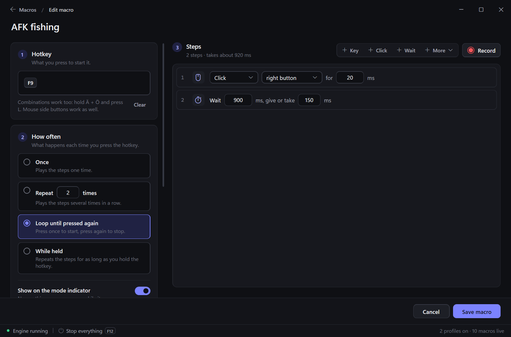
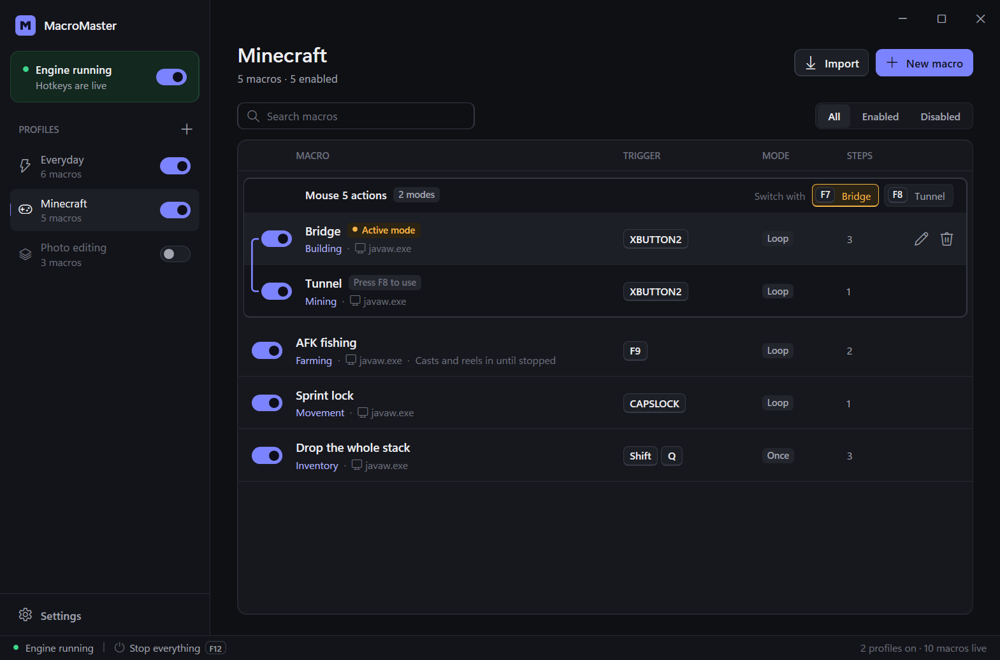
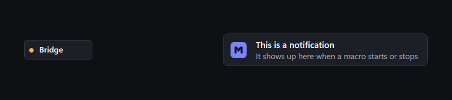
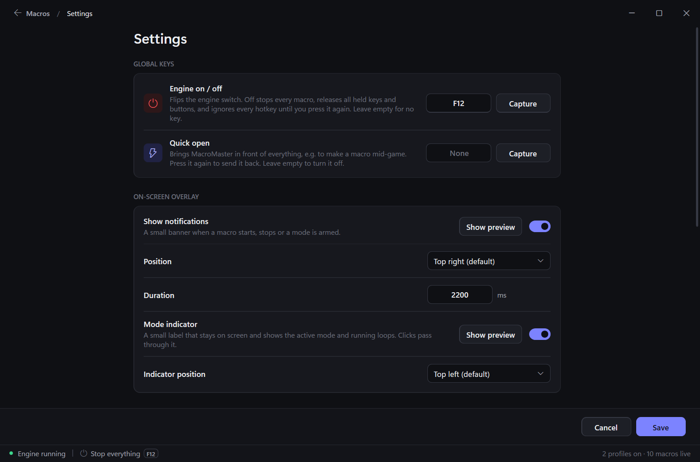

# ⚡ MacroMaster

**Hotkeys, auto clickers and game macros for Windows — built in a clean visual editor, no scripting needed.**

### 📥 [Download MacroMaster (.zip)](https://github.com/OlfJD/MacroMaster/releases/latest/download/MacroMaster-win-x64.zip)

*No installer — extract and run. Updates itself afterwards.*

---

## 🚀 Quick start

1. **[Download the .zip](https://github.com/OlfJD/MacroMaster/releases/latest/download/MacroMaster-win-x64.zip)** and extract it anywhere.
2. Run **`MacroMaster.exe`**. If Windows says .NET is missing, install the free [.NET 10 Desktop Runtime](https://dotnet.microsoft.com/download/dotnet/10.0) (x64) once.
3. Click **New macro**, press the hotkey you want, add steps (or hit **Record** and just do it once yourself), save. Done — the hotkey works everywhere.

`F12` switches every hotkey off and on again, from anywhere — even in a game.

---

## ✨ What it does

### Macros without code
Pick a hotkey, choose **how often** it runs — once, a number of times, in a loop until you press it again, or for as long as you hold the key — and stack up steps: key presses, clicks, waits, mouse moves, scrolling, typed text, media keys, repeat blocks, even *wait until a pixel turns a certain colour*. Every option explains itself when you hover over it.

- **Record** a sequence instead of building it: MacroMaster keeps your exact timing.
- **"Give or take"** on a wait adds random variation (900 ± 150 ms waits anywhere between 750 and 1050 ms) so timing doesn't look robotic.
- Hotkeys can be any key, a combination like `Ctrl + Alt + S`, chords like `Ä + Ö + L`, or the mouse side buttons.

### Profiles per game or app
Group macros into profiles and switch whole profiles on and off. Limit a macro to one program and it only reacts there — and a running loop stops by itself when you alt-tab away.

### Mode groups
Put several macros on the **same hotkey** and pick which one is active with a switch key — e.g. Mouse 5 builds a bridge after `F7` and digs a tunnel after `F8`.

### On-screen overlay
A small notification tells you when a macro starts, stops or a mode switches, and an optional **mode indicator** stays on screen to show the active mode and any loop that's running. Clicks pass straight through it. Put either one in any corner, top or bottom centre — or drag it to exactly the spot you want.

### Made to stay out of the way
- Lives in the tray and **starts with Windows** — as administrator if you like, so hotkeys also work in games that run as administrator (Windows asks once).
- **Updates itself** quietly from GitHub releases, at a moment when no macro is running.
- **Sharp on every screen**: the interface scales with your monitor (1080p, 1440p, 4K) or to the size you pick.
- Precise timing (1 ms timer, hybrid sleep/spin waits), `F12` releases everything that's held down.
- **AutoHotkey import**: drop an `.ahk` script onto the window and its hotkeys become editable macros. Profiles and single macros can be exported and shared as files.

---

## 🛠️ For developers

- C# / WPF on **.NET 10**, Windows only. Run from source with `Run Dev.bat` (needs the .NET 10 SDK).
- Tests: `dotnet test Tests` — they drive the real engine with simulated keys and never touch your keyboard or mouse.
- `DEVLOG.md` has the architecture, a changelog of every change and the to-do list.
- **Releasing**: bump `<Version>` in `MacroMaster.csproj`, publish (`dotnet publish -c Release`), zip the output as `MacroMaster-win-x64.zip` and attach it to a GitHub release tagged `v<version>`. Installed copies pick it up automatically.
