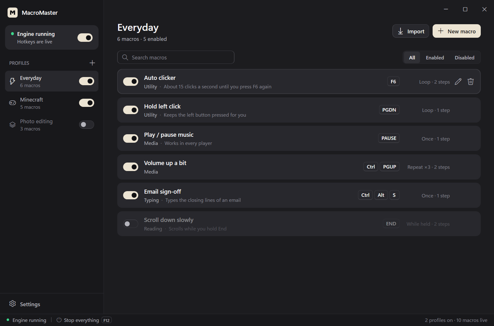
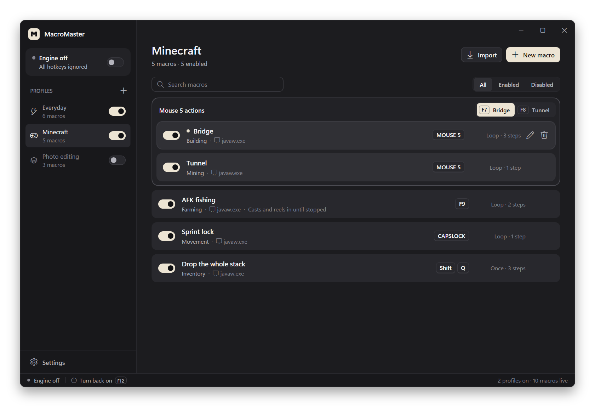

<div align="center">


# MacroMaster

Hotkeys, auto clickers and game macros for Windows, built in a visual editor. No scripting.

[**Download MacroMaster for Windows**](https://github.com/OlfJD/MacroMaster/releases/latest/download/MacroMaster-win-x64.zip)

<br>



</div>

## How it works

- **New macro**: give it a hotkey, pick how often it runs, and add the steps. Or hit **Record** and do it once yourself; the timing is kept.
- **Profiles** hold the macros for one game or app. Switch a whole profile on or off in the sidebar.
- **F12** turns the engine off: every macro stops and held keys are let go. Press it again to turn it back on.
- **Close the window** and it keeps running in the tray. A quick open key (Settings) brings it to the front mid-game.

## Features

- **Hotkeys**: any key, combinations like `Ctrl + Alt + S`, chords like `Ä + Ö + L`, or the mouse side buttons.
- **Four ways to run**: once, a number of times, in a loop until pressed again, or while the key is held.
- **Steps**: keys, clicks, waits, mouse moves, scrolling, typed text, media keys, repeat blocks and *wait until a pixel turns a colour*.
- **Give or take**: a wait of 900 ± 150 ms lasts anywhere between 750 and 1050 ms, so timing doesn't look robotic.
- **Per app**: a macro limited to one program only reacts there, and its loop stops when you alt-tab away.
- **Mode groups**: several macros on one hotkey, with switch keys picking which one runs.
- **On-screen overlay**: a small notification when a macro starts or stops, and an optional mode indicator. Any corner or a spot you drag yourself.
- **Starts with Windows**, as administrator if you like, so hotkeys also work in games that run as administrator.
- **Quiet updates** from GitHub releases, installed when no macro is running.
- **AutoHotkey import**: drop an `.ahk` script on the window. Profiles and single macros export as files.

Notifications don't show over a game in exclusive fullscreen (e.g. Minecraft with `F11`); use windowed or borderless fullscreen.

<details>
<summary>More screenshots</summary>
<br>





</details>

## Requirements

Windows with the [.NET 10 Desktop Runtime](https://dotnet.microsoft.com/download/dotnet/10.0) (x64). Portable: extract the zip and run `MacroMaster.exe`.

## Building

```bash
git clone https://github.com/OlfJD/MacroMaster.git
cd MacroMaster
dotnet run
```

Needs the .NET 10 SDK. `dotnet test Tests` runs the tests; they never touch your keyboard or mouse. To release, bump `<Version>` in `MacroMaster.csproj`, `dotnet publish -c Release`, zip the output as `MacroMaster-win-x64.zip` and attach it to a release tagged `v<version>`. Screenshots in `docs/screenshots` get their rounded corners from `docs/frame_screenshots.ps1`. Architecture, changelog and to-dos are in [DEVLOG.md](DEVLOG.md).
